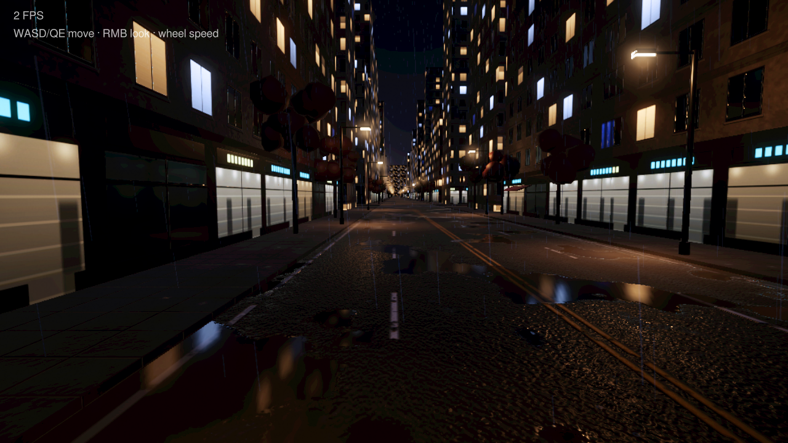

# Legends Racing

Мобильная гонка на Unity 6.3 LTS (URP, Android). Сейчас готов этап 1: открытый город с ночью, дождём и мокрым асфальтом и свободная камера.



## Что есть
- **Город 1×1 км**, процедурный (seed в `GameBootstrap`): сетка дорог на 4 полосы с разметкой и зебрами, тротуары с бордюрами, около 2000 зданий (3 вида фасадов, светящиеся окна, магазины с вывесками, козырьки, кондиционеры и водонапорные башни на крышах), фонари, осенние деревья, дальний силуэт города.
- **Атмосфера:** ночь, дождь (струи и брызги), мокрый асфальт с лужами и отражениями (realtime reflection probe), туман, ореолы фонарей, световые пятна на дороге, bloom, ACES, виньетка, зерно.
- **Свет:** URP Forward+, пул из 28 настоящих точечных источников на ближайших фонарях.
- **Звук:** дождь генерируется кодом, ассеты не нужны.
- **Камера:** на телефоне левый стик двигает, свайп справа крутит обзор, кнопки UP/DN и скорость x1–x3. На ПК WASD, Q/E, ПКМ для обзора, колесо меняет скорость.

## Структура
- `Assets/Scripts/`: `GameBootstrap` (старт, атмосфера, пул фонарей, отражения), `CityGenerator`, `MeshBuilder`, `Effects` (дождь, звук), `FreeCamera` (камера и HUD)
- `Assets/Shaders/`: `Additive`, `HaloBillboard`, `NightSky`
- `Assets/Editor/`: `TextureGen` (все текстуры процедурные), `ProjectSetup` (материалы, пост-обработка, сцена, настройки, сборка)

## Сборка (headless)
```bash
Unity -batchmode -nographics -projectPath . -executeMethod ProjectSetup.SetupAll -quit     # текстуры, материалы, сцена
tools/build_apk.sh                                                                      # Builds/LegendsRacing.apk
Unity -batchmode -nographics -projectPath . -executeMethod ProjectSetup.BuildLinux -quit   # для скриншотов
./Builds/linux/LegendsRacing.x86_64 -legendsShots /tmp/shots                              # 4 кадра и выход
```
APK собирается под ARM64 (IL2CPP, Vulkan, а GLES3 как запасной), minSdk 28.

## Дальше
- Этап 2: машина (физика, камера сзади, звук мотора, брызги из-под колёс)
- Этап 3: трафик, HUD (спидометр, миникарта)
